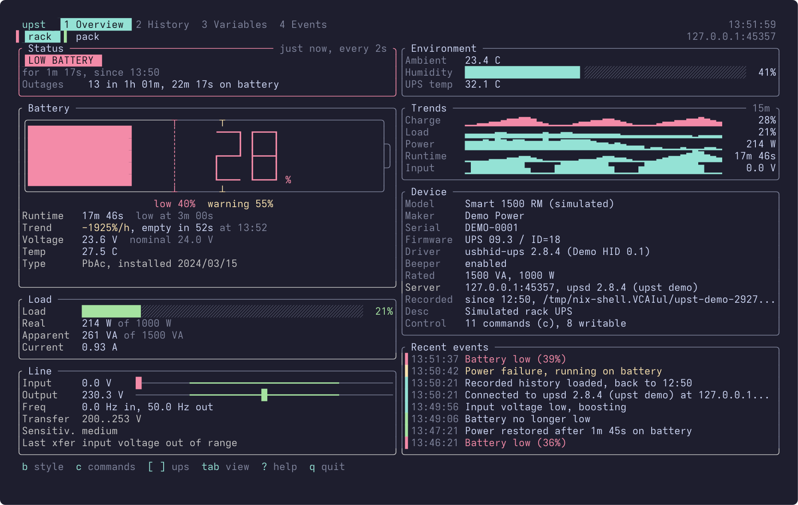
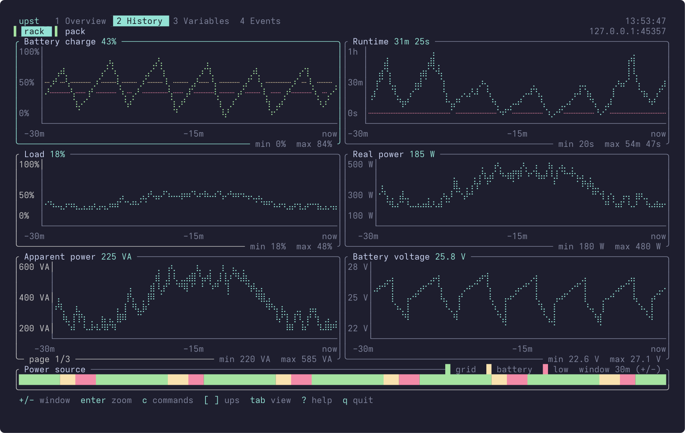
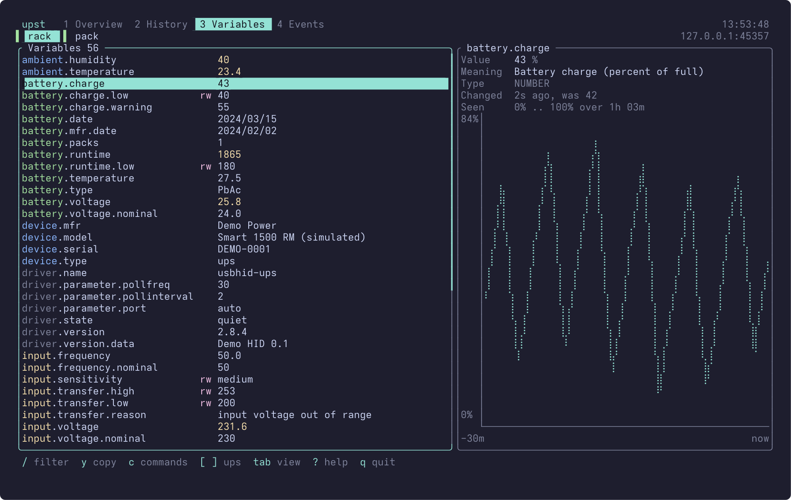
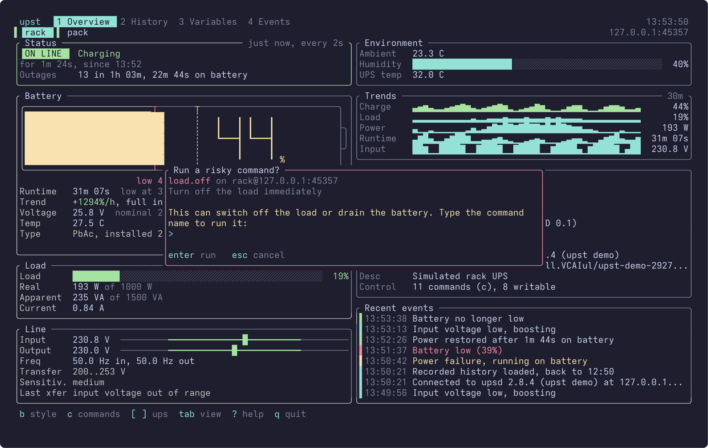
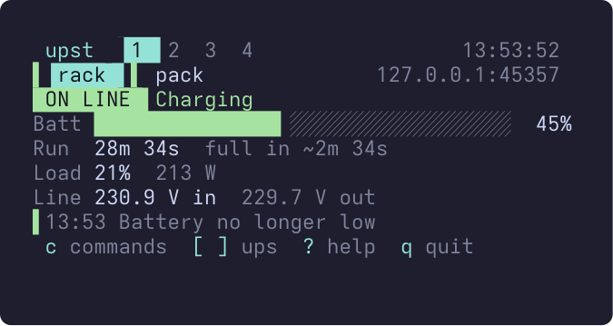
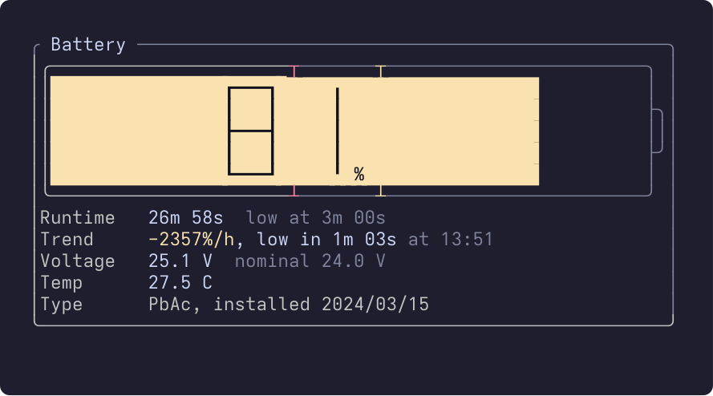
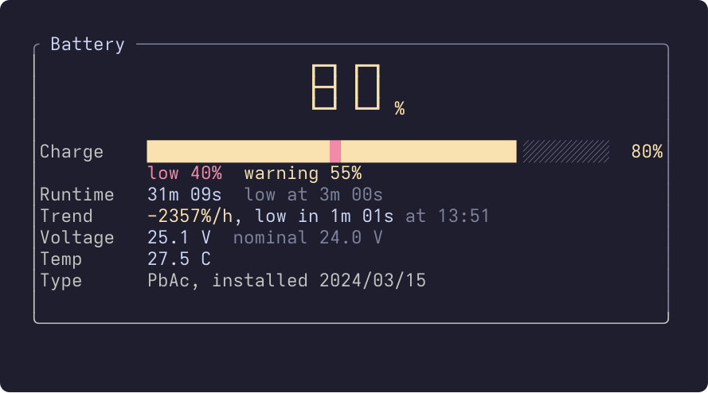
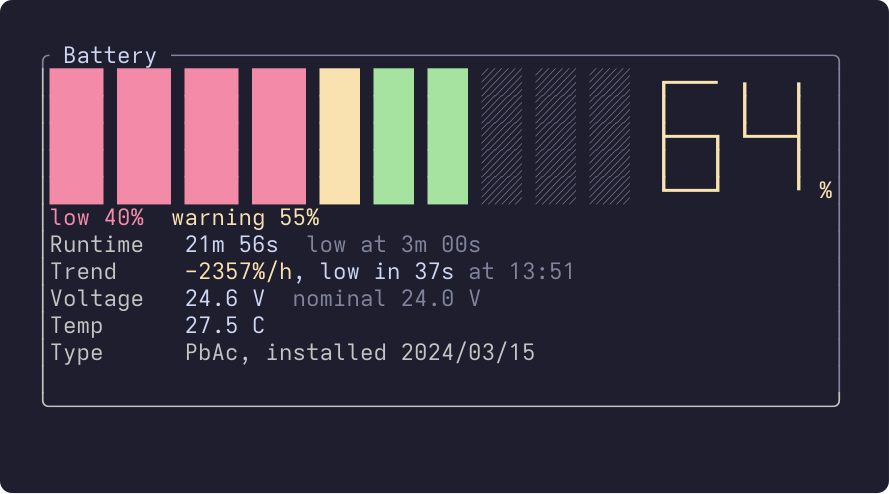
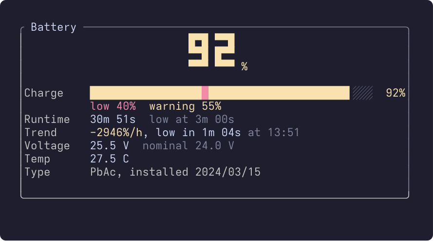

# upst

[](https://github.com/Dolfost/upst/actions/workflows/ci.yml)
[](https://github.com/Dolfost/upst/releases/latest)

A terminal dashboard for UPSes watched by [Network UPS Tools](https://networkupstools.org/).
upst talks to `upsd` over the NUT network protocol, so it works with any UPS that NUT supports, on this machine or across the network, and needs no NUT tools installed where it runs.
The layout follows the terminal size: a three-column dashboard on a wide screen, one column in a narrow one, and a few borderless lines in a small tmux split.
With `upst record` running as a service, it opens with the charts and events of the last days instead of an empty screen.

<p align="center"></p>

## Features

- **Overview** with cards for status, battery, load, line, environment, trends, device and recent events.
  A card appears only when the UPS reports its data. Cards flow into one to three columns and shrink before any is hidden, and spare room goes to a bigger battery, taller sparklines and more events.
- **Five charge styles**: a battery gauge, seven-segment digits like a UPS front panel, a row of LED segments colored by zone, big pixel digits, or a plain bar. `b` switches between them.
- **Bars with thresholds**: the charge marks the low and warning levels, and input and output voltage sit on a meter whose green zone is the transfer range.
- **Estimates** from the observed charge rate: time until low battery or until full, the clock time it will happen, and the average power draw when the battery capacity is known.
  They keep working for devices whose own runtime figure is useless.
- **History**: charts of every series that moves (charge, runtime, load, power, voltages, frequency, temperatures and more) with threshold lines, a window from 1 minute to 7 days, and a ribbon showing when the load ran on grid or battery.
- **Recorded history**: `upst record` keeps a journal of every change per UPS and serves it to upst, which replays it on start, so charts, outages, events and estimates are there from the first second. A NixOS module and systemd units are included.
- **Config file**: every option in TOML, for the whole machine and per user, plus battery capacities per UPS.
- **Variables**: everything the UPS reports, filterable, with upsd's description and type, when it last changed and from what, the range seen and a chart.
  Changed values are highlighted for a few seconds.
- **Events**: power failures, restores with the outage length, low battery, overload, bypass, alarms, self-test results, lost and restored connections.
- **Instant commands and writable variables** with a login dialog, typed confirmation for anything that can cut power, enum and range checks, and result tracking on NUT 2.8+.
- **Several UPSes and servers** at once.
- **Mouse**: click tabs, UPSes, rows and charts; the wheel scrolls lists and zooms the history window.
- **Scriptable**: `--once` prints a line per UPS, optionally from a template for status bars, and `--json` dumps every variable.
- **`--demo`**: a built-in simulated upsd with two UPSes, an outage every few minutes and an hour of recorded history, to try upst without hardware.
- Works on light and dark terminal themes, honors `NO_COLOR`, and has an `--ascii` mode for the Linux console.

| History | Variables |
|---|---|
|  |  |
| **A risky command** | **A 44x9 tmux split** |
|  |  |

### Charge styles

| `battery` (default) | `lcd` |
|---|---|
|  |  |
| **`segments`** | **`blocks`** |
|  |  |

Each style shrinks to a single bar line when the card has no room to spare, and `bar` always is one.
Pick one with `--charge-style`, `charge-style` in the config file or `UPST_CHARGE_STYLE`, or press `b` to try them.

## Install

[Setting up](docs/setup.md) has the requirements, getting upsd ready, the config file and the recorder service in detail.

### Prebuilt binaries

[Releases](https://github.com/Dolfost/upst/releases/latest) have static Linux binaries for x86_64 and aarch64, and macOS binaries for Intel and Apple silicon:

```sh
curl -L https://github.com/Dolfost/upst/releases/latest/download/upst-x86_64-unknown-linux-musl.tar.gz | tar xz
sudo install upst-*/upst /usr/local/bin/
```

The other archives are `upst-aarch64-unknown-linux-musl`, `upst-x86_64-apple-darwin` and `upst-aarch64-apple-darwin`.
Each holds the binary, the systemd units, the example config file and the docs, and `SHA256SUMS` has their checksums.

### Nix

Try it without installing:

```sh
nix run github:Dolfost/upst -- --demo
```

Install into your profile:

```sh
nix profile install github:Dolfost/upst
```

In a NixOS or home-manager flake, add the input and use the package or the overlay:

```nix
{
  inputs.upst.url = "github:Dolfost/upst";

  # In a module, with `inputs` passed through specialArgs:
  environment.systemPackages = [ inputs.upst.packages.${pkgs.stdenv.hostPlatform.system}.default ];
  # or home.packages = [ ... ], or
  # nixpkgs.overlays = [ inputs.upst.overlays.default ]; and then pkgs.upst
}
```

For the history recorder, see [Recorded history](#recorded-history).

### Cargo

Needs Rust 1.88 or newer.

```sh
cargo install --git https://github.com/Dolfost/upst
```

## Usage

```sh
upst                      # every UPS on localhost
upst ups@nas.lan          # one UPS on another host
upst @nas.lan rack@pi     # everything on nas.lan, plus one UPS on pi
upst --demo               # a simulated upsd
```

Targets use the upsc syntax `ups[@host[:port]]`.
`@host` (or `*@host`) means every UPS on that server; IPv6 addresses go in brackets, as in `ups@[::1]:3493`.
Without a target upst watches every UPS on localhost.
`UPST_TARGETS=ups@a,@b` works too.

| Option | Default | |
|---|---|---|
| `-i`, `--interval TIME` | `2s` | Time between polls; `<` and `>` change it while running. |
| `--history TIME` | `24h` | How much history to keep for charts and estimates, and to load from the recorder. |
| `--timeout TIME` | `5s` | Connect and reply timeout. |
| `-u`, `--user USER` | | upsd user for commands and SET (`UPST_USER`). |
| `--password-file PATH` | | File whose first line is the password (`UPST_PASSWORD_FILE`, or the password itself in `UPST_PASSWORD`). |
| `--capacity WH` | | Battery capacity, for Wh left and power draw. |
| `--view VIEW` | `overview` | Start on `overview`, `history`, `variables` or `events`. |
| `--charge-style STYLE` | `battery` | `battery`, `lcd`, `segments`, `blocks` or `bar` (`UPST_CHARGE_STYLE`). |
| `--recorder ADDR` | see below | `upst record` to load history from: a socket path or `host[:port]` (`UPST_RECORDER`). |
| `--no-recorder` | | Do not look for a recorder. |
| `--ascii` | | ASCII bars, sparklines and charts. |
| `--no-color` | | No colors. `NO_COLOR` works too. |
| `--no-mouse` | | Leave the mouse to the terminal, so text selection works as usual. |
| `--bell` | | Ring the terminal bell on power events. |
| `--once` | | Print one line per UPS and exit. |
| `--format TEMPLATE` | | Line template for `--once`. |
| `--json` | | Print every variable of every UPS as JSON and exit. |
| `--demo` | | Watch the built-in simulated upsd. |
| `--config PATH` | see below | Config file to read instead of the default ones (`UPST_CONFIG`). |

Times accept `500ms`, `2`, `10s`, `5m`, `6h` and `1d`.

### Config file

Each long option except `--once`, `--json` and `--demo` can also go in `/etc/upst/config.toml` (for everyone) or `~/.config/upst/config.toml` (yours, which wins), named after the option:

```toml
targets = ["@nas.lan", "rack@pi.lan"]
charge-style = "lcd"
history = "48h"

[ups."rack@pi.lan"]
capacity = 864       # Wh, for this UPS only

[record]             # upst record
keep = "30d"
```

The command line and the `UPST_*` variables win over both files.
[contrib/config.toml](contrib/config.toml) lists every key, and [Setting up](docs/setup.md#the-config-file) describes them.

### Keys

| Key | |
|---|---|
| `1`-`4`, `Tab`, `Shift+Tab` | Overview, History, Variables, Events |
| `[` `]` | Previous / next UPS |
| `b` | Next charge style |
| `r` | Poll now |
| `p` | Pause polling |
| `<` `>` | Poll faster / slower |
| `c` | Instant commands |
| `?` | Help |
| `q`, `Ctrl+C` | Quit |

History: arrows or `hjkl` pick a chart, `Enter` or `z` zooms it, `+` and `-` change the window (it also sets the Trends card on the overview).
Variables: `j` `k` `PgUp` `PgDn` `g` `G` move, `/` filters by name or value (`Enter` keeps the filter, `Esc` clears it), `e` or `Enter` changes a writable variable, `y` copies the value through OSC 52.
Events: `j` `k` scroll, `f` switches between all UPSes and the current one.
While upst has the mouse, most terminals still select text with `Shift` held.

### Scripting

```console
$ upst --once
ups@localhost: ON LINE, battery 100%, runtime 5d 12h

$ upst --once --format '{charge} {runtime} {status}'
100% 5d 12h ON LINE

$ upst --json | jq -r '."ups@localhost"."battery.voltage"'
13.0
```

A placeholder is any variable name, like `{battery.voltage}`, or one of `{ups}`, `{status}` (the headline, such as `ON BATTERY`), `{flags}` (raw `ups.status`), `{charge}`, `{runtime}` (formatted) and `{load}`.
A missing value prints `-`; `{{` and `}}` are literal braces.
The exit status is 1 when any target could not be read.

A waybar module, for example:

```json
"custom/ups": {
  "exec": "upst --once --format '{charge} {status}'",
  "interval": 30
}
```

## Recorded history

On its own, upst knows only what it saw since it started.
`upst record` runs in the background, polls the same way, and appends every change to a journal per UPS; upst asks it for the last `--history` (24 hours by default) when it starts and replays it, so the charts, the outage count, the events with their real times and the charge-rate estimates are all there at once.
Polls that arrive meanwhile wait for the replay, and anything after the recorder's last entry comes from upst's own polls as usual.
Time the recorder did not run shows as a gap in the power ribbon.

### Running it

On NixOS, import the module and enable it:

```nix
{
  imports = [ inputs.upst.nixosModules.default ];
  services.upst.enable = true;
}
```

This runs `upst.service` as a dynamic user in a hardened sandbox, keeps the journals in `/var/lib/upst`, serves them on `/run/upst/upst.sock`, and puts `upst` on the `PATH`.
`services.upst.settings` becomes `/etc/upst/config.toml`, with the recorder's settings under `record`.

Elsewhere, [contrib/upst.service](contrib/upst.service) is the same service as a systemd unit, and [contrib/upst-user.service](contrib/upst-user.service) a user service that records while you are logged in.
Or run it by hand:

```sh
upst record                                        # every UPS on localhost
upst record ups@localhost @nas.lan --keep 30d
upst record --dir /srv/upst --listen /run/upst/upst.sock --listen 0.0.0.0:3494
```

Its options are `--interval` (`5s`), `--keep` (`7d`), `--dir`, `--listen` and `--timeout`, or the `[record]` table of the config file.
[Setting up](docs/setup.md#run-the-recorder) covers each way, the module's options and serving other machines.

### Which recorder upst uses

Without `--recorder`, upst tries `/run/upst/upst.sock` (the system service) and then `$XDG_RUNTIME_DIR/upst/upst.sock` (a user service), and quietly goes without history when neither exists.
For a recorder on another machine, have it `--listen` on TCP (port 3494 is the default) and point upst at it:

```sh
upst ups@nas.lan --recorder nas.lan
```

Each UPS is matched to the journal with the same name and server, where the recorder's own `localhost` counts as the host it runs on; failing that, to the only journal with that UPS name.
The Device card shows where the history came from and how far back it goes.

### Journal and protocol

A journal is a text file of one line per change, which makes it easy to read, `grep` or feed to something else:

```text
# upst journal 1 ups@localhost
1762646400 !start
1762646400 !up
1762646400 battery.charge 100
1762646400 ups.status OL
1762646460 !tick
1762646471 battery.charge 99
1762646500 !down Connection refused
```

Each line has a Unix time and either a variable with its value, `-name` for a variable that went away, or a marker: `!start` when the recorder starts, `!up` when polls succeed, `!down` and `!nodata` when upsd or the UPS stop answering, and `!tick` once a minute when nothing changed, so a longer silence means the recorder was not running.

The socket speaks a line protocol in the style of upsd's, so `socat` or `nc` is enough to look inside:

```console
$ echo LIST | socat - UNIX-CONNECT:/run/upst/upst.sock
BEGIN LIST
UPS ups@localhost 1762646400 1762732800
END LIST
```

`GET <label> [<since>]` returns the journal from that time on, opening with the state just before it, and `VER` names the version.
Anyone who can reach the socket can read the history, just as anyone who can reach upsd can read the variables; the recorder holds no credentials and sends no commands.

## Instant commands and writable variables

`c` lists the UPS's instant commands with upsd's descriptions.
In the Variables view `e` changes a writable variable (marked `rw`), offering the allowed values of an enum and checking ranges and string lengths before sending.

Both need an upsd user that is allowed to do it, in `upsd.users`:

```ini
[upst]
    password = something-long
    instcmds = ALL
    actions = SET
```

or on NixOS:

```nix
power.ups.users.upst = {
  passwordFile = "/run/secrets/upsd-upst";
  instcmds = [ "ALL" ];
  actions = [ "SET" ];
};
```

upst asks for the login the first time it needs one and keeps it in memory for the session; `--user` with `--password-file` or `UPST_PASSWORD` skips the prompt.
Commands log in on their own short-lived connection, so the polling connection never carries credentials, and watching alone needs no login at all, the same as upsc.

Commands that can switch off the load or drain the battery (`shutdown.*`, `load.off*`, `driver.killpower`, `calibrate.start`, deep battery tests, `bypass.start`) are marked with `!` and run only after you type their name.
Everything else asks for a plain `y`.
On NUT 2.8 and newer upst turns on result tracking and reports whether the driver actually ran the command, not only that upsd accepted it.

## How the estimates work

UPSes report charge in whole percent, so upst measures the rate between the moments the charge steps, over the last dozen steps of the current charge or discharge.
If no step comes for much longer than usual it falls back to the slower average, and while only one step has been seen the estimate is marked with `~`.
Time to low uses `battery.charge.low`; time to full assumes 100%.
With a known capacity (`--capacity`, or detected as below) the rate becomes an average power in watts, and the charge becomes Wh left.
Some devices never set `CHRG`; for them a rising charge while on line counts as charging.
With recorded history the steps before upst started count too, so a slow discharge has an estimate at once.

## Device notes

**EcoFlow power stations** (seen with a Delta 3 Max Plus on the usbhid-ups EcoFlow subdriver in NUT 2.8.4) put the pack's capacity in Wh into `ups.power.nominal`, so upst takes it as the capacity instead of showing it as VA.
They also report the app's discharge limit as `battery.charge.low` (0 while the limit is off), never set `CHRG`, give the runtime in whole minutes capped at about 5.5 days, and have no live power reading over HID.
NUT raises low battery only below `battery.charge.low`, so set `override.battery.charge.low` in `ups.conf` if the app limit is off.

## How it works

One thread per upsd server keeps a connection open, runs `LIST VAR` for each UPS every interval, reconnects with backoff, and fetches descriptions when you look at a variable.
The UI thread folds the answers into per-UPS state, history and events, and redraws.
upst itself writes nothing to disk; its history lives in memory for `--history`.
`upst record` uses the same pollers and writes what changed to its journals, and another thread asks it for them when upst starts.

## Development

```sh
nix develop               # cargo, rustc, clippy, rustfmt, rust-analyzer, NUT tools
cargo run -- --demo
cargo test
```

The tests include protocol round trips against the demo server, every key of the example config file and its precedence over defaults and under the command line, the recorder serving its journals over both kinds of socket, the replay of a journal with outages and gaps, every charge style at every size, and every view rendered at sizes from 1x1 to 220x70.
To look at frames without a terminal:

```sh
UPST_SNAP=120x40,80x24 UPST_VIEWS=1234 UPST_STYLE=lcd cargo test snapshots -- --ignored --nocapture
```

`nix flake check` builds the package and runs the same tests; on Linux it also boots a NixOS VM with a dummy UPS and the recorder service, and checks that the module's settings reach the recorder and every user's upst, and that an ordinary user's upst finds the recorder and loads its history.
The demo password `wrong` is refused, to exercise the failure path.
`docs/screenshots.sh` regenerates the images in this README from the demo; the header comment lists the tools it needs.

To release, set the new version in `Cargo.toml`, add a section for it to [CHANGELOG.md](CHANGELOG.md), and push a tag:

```sh
git tag v0.2.0 && git push origin v0.2.0
```

The release workflow checks that the tag, `Cargo.toml` and the changelog agree, builds the four binaries and publishes them with the changelog section as the notes.

## License

[Apache-2.0](LICENSE)
